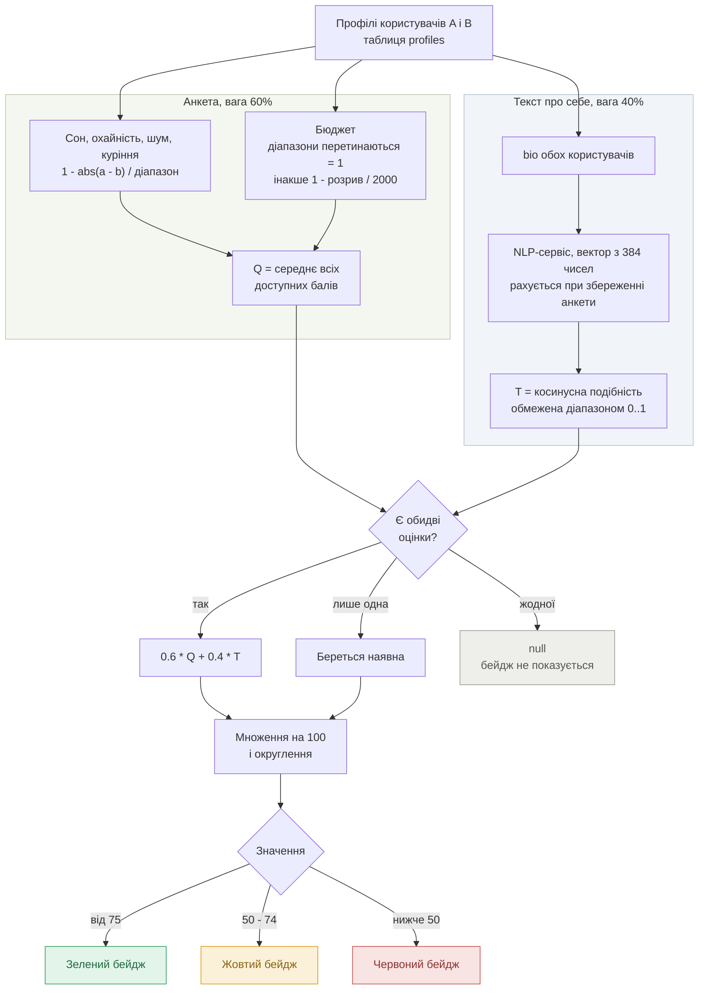
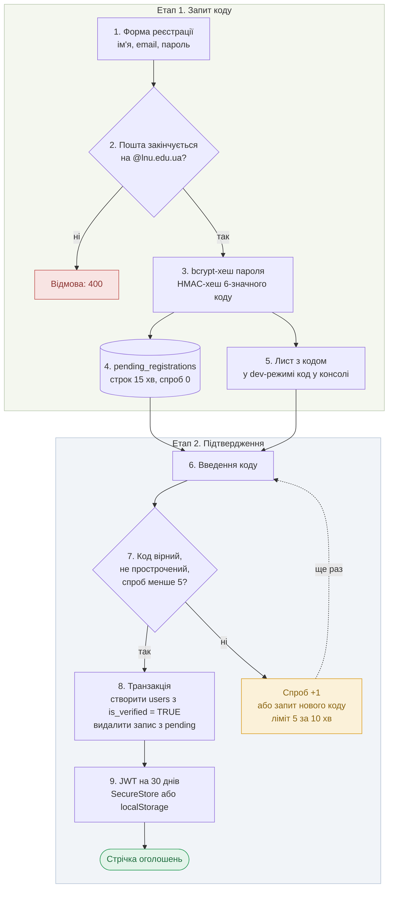

# StudShare

Платформа для студентів ЛНУ імені Івана Франка, яка допомагає знайти житло та співмешканців у Львові. Ключова ідея: знайти не просто квартиру, а **людей, з якими комфортно жити**. 

## Про проєкт

StudShare поєднує дві групи студентів: тих, хто вже має квартиру чи кімнату і шукає ще одну людину, та тих, хто шукає, до кого підселитися. Окрім звичайної дошки оголошень, застосунок рахує **сумісність** між користувачами: порівнює їхні звички (режим сну, охайність, рівень шуму, куріння), бюджет і текстовий опис «про себе», щоб підказати, з ким буде комфортно жити разом.

Реєстрація доступна лише з університетською поштою `@lnu.edu.ua` з обов'язковим підтвердженням кодом, тож спільнота лишається студентською.

### Де працює

Клієнт написаний один раз на Expo / React Native і працює на кількох платформах:

- у браузері на комп'ютері (веб-версія з верхньою навігацією та адаптивною сіткою оголошень);
- як мобільний застосунок на iOS та Android (нижня панель вкладок, нативні карти).

Один і той самий код обслуговує всі платформи, а платформо-специфічні місця (карта, зберігання токена, вставка фото) винесені в окремі модулі.

## Можливості

- Реєстрація з університетською поштою та підтвердження 6-значним кодом.
- Два типи оголошень: «Маю житло» та «Шукаю підселення».
- Стрічка з фільтрами за типом, районом, максимальною ціною та статтю.
- До 6 фото на оголошення житла: додавання, видалення, заміна.
- Карта Львова з оголошеннями, адреси автоматично перетворюються на координати.
- Обране з миттєвим оновленням інтерфейсу.
- Анкета співмешканця: повзунки звичок, бюджет, опис про себе.
- Відсоток сумісності на картках оголошень і на сторінках профілів.
- Редагування, видалення та закриття оголошення кнопкою «Місце знайдено».
- Зв'язок з автором через Telegram або телефон.
- Відкриття адреси в Apple Maps чи Google Maps.
- Інтерактивна документація API (Swagger).

## Технології

| Шар | Стек |
| --- | --- |
| Клієнт | Expo SDK 58, React Native 0.88, React 19, Expo Router (файлова маршрутизація), TypeScript, Axios |
| Карти | `react-native-maps` (мобільні), Leaflet + OpenStreetMap (веб) |
| Сервер | Node.js, Express 5, `mysql2`, `jsonwebtoken`, `bcryptjs`, `multer`, `nodemailer`, `express-rate-limit`, `swagger-jsdoc`, `swagger-ui-express` |
| База даних | MySQL 8.0 (у Docker) |
| NLP-сервіс | Python, FastAPI, Uvicorn, `sentence-transformers` (модель `paraphrase-multilingual-MiniLM-L12-v2`) |
| Геокодування | Nominatim (OpenStreetMap) |

Також у клієнті ввімкнені React Compiler і типізовані маршрути (`typedRoutes`).

## Структура репозиторію

```
.
├── backend/                 REST API на Express
│   ├── routes/              auth, posts, favorites, profile
│   ├── middleware/          auth (JWT), requireVerified
│   ├── services/            compatibility, nlp, geocode, mailer, posts
│   ├── uploads/             завантажені фото (не комітяться)
│   ├── seed-uploads/        демо-фото для тестових даних
│   ├── db.js                пул з'єднань MySQL
│   ├── swagger.js           опис OpenAPI
│   └── server.js            точка входу
├── mobile/                  Expo-застосунок (iOS, Android, веб)
│   ├── app/                 екрани та маршрути
│   │   ├── (auth)/          login, register, verify
│   │   ├── (tabs)/          стрічка, карта, обране, профіль
│   │   ├── post/            перегляд, створення, редагування
│   │   └── user/            профіль іншого студента
│   ├── components/          Button, Chips, PostCard, PostsMap, PhotoPicker, ...
│   ├── context/             AuthContext, FavoritesContext
│   ├── services/            api, config, maps, tokenStorage, uploadPhotos
│   ├── data.ts              райони, риси анкети
│   ├── theme.ts             кольори та базові стилі
│   └── types.ts             спільні типи
├── nlp-service/             FastAPI-сервіс текстових ембедингів
│   ├── main.py
│   └── requirements.txt
├── database/
│   ├── schema.sql           повна схема
│   ├── seed-demo.sql        демо-дані
│   └── migrations/          поступові зміни для наявних баз
├── docker-compose.yml       MySQL
└── .env.example             шаблон змінних середовища
```

## Схема бази даних

| Таблиця | Призначення |
| --- | --- |
| `users` | Підтверджені акаунти: ім'я, email, хеш пароля, прапорець `is_verified` |
| `pending_registrations` | Незавершені реєстрації: тимчасові дані, хеш коду, строк дії, лічильник спроб |
| `profiles` | Анкета: `sleep`, `cleanliness`, `noise` (1–5), `smoking` (1–3), бюджет, `bio` та `bio_embedding` (JSON) |
| `posts` | Оголошення: тип, ціна, район, стать, адреса, координати, контакт, статус `open` / `closed` |
| `post_photos` | Імена файлів фото, прив'язані до оголошення |
| `favorites` | Зв'язок «користувач — оголошення» з унікальною парою ключів |

Зв'язки: `profiles`, `posts` і `favorites` посилаються на `users`; `post_photos` і `favorites` посилаються на `posts`. Усі зовнішні ключі мають `ON DELETE CASCADE`, тому видалення оголошення чи користувача не залишає «сиріт».

## Сумісність

Сумісність показує, наскільки двоє студентів підходять один одному за способом життя. Система складається з чотирьох частин: збір даних (анкета), векторизація тексту «про себе», формула в `backend/services/compatibility.js` та відображення в інтерфейсі.

Коректність формули перевіряють Jest-тести в `backend/services/compatibility.test.js`. Запустити їх можна командою `cd backend && npm test`.

### Схема



### Які дані враховуються

Усе береться з анкети користувача (таблиця `profiles`, екран профілю). Усі поля необов'язкові.

| Поле | Діапазон | Що означає |
| --- | --- | --- |
| `sleep` | 1–5 | жайворонок → сова |
| `cleanliness` | 1–5 | невимушено → педантично |
| `noise` | 1–5 | тиша → гучно й весело |
| `smoking` | 1–3 | проти → курю |
| `budget_min`, `budget_max` | грн | бюджет на місяць |
| `bio` + `bio_embedding` | текст + вектор | опис «трохи про себе» |

Ціна оголошення, його тип і стать у розрахунку не беруть участі. Стать працює лише як фільтр у стрічці.

### Як текст перетворюється на число

- Під час збереження анкети (`PUT /api/profile`) бекенд надсилає `bio` у NLP-сервіс (`POST /embed`).
- Модель `paraphrase-multilingual-MiniLM-L12-v2` повертає нормалізований вектор із 384 чисел. Вона мультимовна, тому українські тексти розуміє.
- Вектор зберігається в `profiles.bio_embedding` як JSON і перераховується лише коли змінився текст.
- Якщо NLP-сервіс недоступний, анкета все одно зберігається, а текстова частина просто не рахується. Під час наступного збереження з непорожнім `bio` бекенд спробує ще раз. Якщо `bio` очистити, вектор стає `null`.
- Вектор ніколи не віддається клієнту.

### Формула

**Анкетна частина Q.** Для кожної риси, якщо значення є в обох користувачів:

```
score = 1 - abs(a - b) / range
```

`range` — максимально можлива різниця: 4 для сну, охайності та шуму, 2 для куріння. Однакові значення дають 1.0, протилежні крайні дають 0.0.

Бюджет, якщо в обох вказано `budget_max` (порожній `budget_min` вважається нулем):

```
gap   = max(minA, minB) - min(maxA, maxB)
score = gap <= 0 ? 1 : max(0, 1 - gap / 2000)
```

Якщо діапазони перетинаються, бал 1. Якщо ні, кожні 1000 грн розриву знімають 0.5, а від 2000 грн бал дорівнює 0. Усі отримані бали (від нуля до п'яти) усереднюються з однаковою вагою, бюджет вважається одним із рівноправних пунктів.

**Текстова частина T.** Косинусна подібність двох векторів (через нормалізацію це просто скалярний добуток), обмежена діапазоном від 0 до 1.

**Підсумок:**

```
є Q і T       ->  round((0.6 * Q + 0.4 * T) * 100)
є лише Q      ->  round(Q * 100)
є лише T      ->  round(T * 100)
немає нічого  ->  null
```

### Приклад

| | Я | Інший |
| --- | --- | --- |
| sleep | 4 | 5 |
| cleanliness | 3 | 5 |
| noise | 2 | 2 |
| smoking | 1 | 1 |
| бюджет | 3000–5000 | 4000–6000 |

Розрахунок:

- sleep: 1 - 1/4 = 0.75
- cleanliness: 1 - 2/4 = 0.50
- noise: 1.0
- smoking: 1.0
- бюджет: gap = 4000 - 5000 = -1000, діапазони перетинаються, отже 1.0
- Q = (0.75 + 0.5 + 1 + 1 + 1) / 5 = 0.85
- T: нехай косинусна подібність текстів дорівнює 0.55
- підсумок: 0.6 * 0.85 + 0.4 * 0.55 = 0.51 + 0.22 = 0.73, тобто **73%** (жовтий бейдж)

### Кольори бейджа

Колір бейджа залежить від значення:

| Значення | Колір |
| --- | --- |
| $\color{#2e9e5b}{\textsf{75–100\%}}$ | зелений |
| $\color{#d99a1b}{\textsf{50–74\%}}$ | жовтий |
| $\color{#c0504d}{\textsf{0–49\%}}$ | червоний |

## Реєстрація та безпека

Реєстрація двоетапна, і акаунт створюється тільки після підтвердження пошти.

1. `POST /api/auth/register` перевіряє, що пошта з домену `@lnu.edu.ua`, і зберігає дані в `pending_registrations`, надсилає код на пошту.
2. `POST /api/auth/verify` перевіряє код і в одній транзакції створює користувача та видаляє запис з очікування.
3. Після цього повертається JWT, і користувач одразу входить у застосунок.

### Потік реєстрації



Що захищено:

- **Домен пошти.** Дозволена лише пошта `@lnu.edu.ua`. Домен задається змінною `ALLOWED_EMAIL_DOMAIN`.
- **Код підтвердження.** Генерується криптографічно стійким генератором, у базі зберігається лише HMAC-SHA256 хеш, порівняння виконується через `timingSafeEqual`. Код діє 15 хвилин, після 5 невдалих спроб потрібно запросити новий.
- **Паролі** хешуються через bcrypt.
- **Обмеження частоти запитів:** 30 запитів за 15 хвилин на авторизацію та 5 запитів коду за 10 хвилин.
- **Розкриття інформації.** Відповідь на повторне надсилання коду однакова незалежно від того, чи існує очікувана реєстрація для цієї адреси.
- **Гонки.** Перевірка коду виконується в транзакції з `SELECT ... FOR UPDATE`.
- **Права доступу.** Створювати й змінювати оголошення можуть лише підтверджені користувачі (`requireVerified`), редагувати і видаляти лише власні пости та фото.
- **Завантаження файлів.** Дозволені лише JPG, PNG і WEBP до 5 МБ, імена файлів випадкові, при помилках тимчасові файли прибираються.
- **SQL.** Усі запити параметризовані.
- **Токен.** На мобільних пристроях зберігається в `expo-secure-store`, у браузері в `localStorage`. Термін дії JWT — 30 днів.

## Карти та геокодування

**Геокодування.** Коли користувач публікує оголошення про житло, бекенд перетворює адресу на координати через Nominatim, додаючи до запиту «Львів, Україна». Координати перераховуються лише тоді, коли адресу змінили. Якщо адресу не вдалося визначити, оголошення все одно створюється, а застосунок підказує вказати вулицю і номер точніше.

**Карта в застосунку.** На телефоні використовується `react-native-maps` (Google Maps на Android, Apple Maps на iOS), у браузері — Leaflet з тайлами OpenStreetMap, який завантажується динамічно. Маркери ведуть на сторінку оголошення, карта автоматично підлаштовує масштаб під знайдені точки. Дані підтягує ендпоінт `GET /api/posts/nearby`, який шукає оголошення в заданому радіусі за допомогою `ST_Distance_Sphere`.

**Відкриття у зовнішніх картах.** Кнопка «Показати на карті» формує посилання на Google Maps або Apple Maps. На iOS користувачеві пропонується вибір застосунку.

## Додатково

- Фільтр за статтю показує оголошення потрібної статі разом з тими, де стать неважлива.
- Фото на вебі можна вставляти прямо з буфера обміну (`Ctrl+V`).
- Додавання в обране оновлює інтерфейс одразу, а при помилці мережі змінa відкочується.
- Інтерфейс адаптується до ширини екрана: сітка в дві колонки на великих екранах, одна колонка на телефоні.
- Swagger-документація доступна за адресою `/api-docs`, токен зберігається між оновленнями сторінки.
- Демо-акаунти: `test1@lnu.edu.ua`, `test2@lnu.edu.ua`, `test3@lnu.edu.ua` з паролем `123456` (тільки для локальної розробки).

## Встановлення та запуск

### Вимоги

- Node.js 22.13 або новіший
- Docker та Docker Compose
- Python 3.10 або новіший (для NLP-сервісу)

### 1. Налаштування середовища

```bash
git clone <адреса-репозиторію>
cd <назва-папки>
cp .env.example .env
```

Відкрийте `.env` і заповніть `DB_PASSWORD`, `DB_ROOT_PASSWORD` та `JWT_SECRET`. Для кожного секрету згенеруйте окреме випадкове значення:

```bash
node -e "console.log(require('crypto').randomBytes(32).toString('hex'))"
```

SMTP налаштовувати необов'язково: без нього код підтвердження виводиться в консоль бекенду. Як налаштувати надсилання справжніх листів, описано нижче в розділі «Налаштування пошти для кодів».

### Налаштування пошти для кодів (необов'язково)

Код підтвердження надсилається з окремої поштової скриньки-відправника на адресу студента, який реєструється. Скринька-відправник може бути будь-якою, вона не повинна бути з домену `@lnu.edu.ua`. Найпростіший варіант — окремий акаунт Gmail, створений саме для проєкту.

Змінні в `.env`:

| Змінна | Що вказати |
| --- | --- |
| `SMTP_HOST` | Адреса SMTP-сервера, для Gmail `smtp.gmail.com` |
| `SMTP_PORT` | `587` (STARTTLS) або `465` (TLS) |
| `SMTP_USER` | Повна адреса скриньки-відправника |
| `SMTP_PASS` | Пароль застосунку (не звичайний пароль від пошти) |
| `MAIL_FROM` | Адреса відправника, зазвичай збігається з `SMTP_USER` |

**Як отримати пароль застосунку Google (`SMTP_PASS`):**

1. Увійдіть в акаунт Google, який буде відправником, і відкрийте [myaccount.google.com](https://myaccount.google.com).
2. Увімкніть двоетапну перевірку: Безпека, потім «Двоетапна перевірка». Без неї сторінка паролів застосунків недоступна.
3. Відкрийте [myaccount.google.com/apppasswords](https://myaccount.google.com/apppasswords).
4. Введіть довільну назву, наприклад `StudShare`, і натисніть «Створити».
5. Google покаже пароль із 16 символів. Скопіюйте його одразу, повторно він не відображається.
6. Вставте пароль у `.env` **без пробілів**.

Приклад заповненого блоку:

```dotenv
SMTP_HOST=smtp.gmail.com
SMTP_PORT=587
SMTP_USER=studshare.project@gmail.com
SMTP_PASS=abcdefghijklmnop
MAIL_FROM=studshare.project@gmail.com
```

Після зміни `.env` перезапустіть бекенд. Кілька зауважень:

- Пароль застосунку не можна комітити в репозиторій, файл `.env` уже в `.gitignore`.
- Якщо змінити пароль від акаунта Google, пароль застосунку буде скасовано і його потрібно створити заново.
- У робочих акаунтах Google Workspace адміністратор може вимкнути паролі застосунків, тоді використовуйте звичайний Gmail.
- Для іншого провайдера вкажіть його SMTP-хост, порт та облікові дані.
- Якщо надіслати лист не вдалося, реєстрація повертає помилку 503, а користувач може запросити код повторно.

### 2. База даних

```bash
docker compose up -d
```

При першому запуску автоматично виконуються `schema.sql` та `seed-demo.sql`, тож база одразу містить демо-користувачів і оголошення. Якщо у вас уже є база зі старою схемою, застосуйте файли з `database/migrations/` по черзі.

### 3. Бекенд

```bash
cd backend
npm install
npm run dev
```

Сервер стартує на `http://localhost:3000`, документація доступна на `http://localhost:3000/api-docs`.

### 4. NLP-сервіс

```bash
cd nlp-service
python -m venv .venv
source .venv/bin/activate        # у Windows: .venv\Scripts\activate
pip install -r requirements.txt
uvicorn main:app --port 8000
```

При першому запуску завантажується модель, тому він триває довше. Адресу сервісу можна змінити змінною `NLP_URL` (за замовчуванням `http://localhost:8000`). Без цього сервісу застосунок працює, але без текстової частини сумісності.

### 5. Клієнт

```bash
cd mobile
npm install
npx expo start
```

Далі оберіть платформу:

- натисніть `w`, щоб відкрити веб-версію в браузері;
- натисніть `a` або `i` для емулятора Android чи симулятора iOS;
- або скануйте QR-код застосунком Expo Go на телефоні.

Адреса API визначається автоматично за IP комп'ютера, на якому запущений Expo. За потреби задайте її вручну:

```bash
EXPO_PUBLIC_API_URL=http://192.168.0.12:3000/api npx expo start
```

Якщо змінюєте `ALLOWED_EMAIL_DOMAIN`, оновіть також регулярний вираз `UNI_EMAIL` у `mobile/app/(auth)/register.tsx`, щоб клієнтська перевірка збігалася із серверною.

## Що можна робити після запуску

1. Зареєструватися зі своєю поштою `@lnu.edu.ua` і підтвердити її кодом. Без SMTP код видно в консолі бекенду.
2. Переглядати стрічку оголошень і фільтрувати її за типом, районом, ціною та статтю.
3. Відкрити оголошення, переглянути фото, опис, автора та написати йому в Telegram або за телефоном.
4. Дивитися оголошення на карті Львова й відкривати адресу в Google Maps чи Apple Maps.
5. Додавати оголошення в обране і повертатися до них у вкладці «Обране».
6. Заповнити анкету у профілі: звички, бюджет і текст про себе. Після цього на оголошеннях та профілях інших студентів з'являється відсоток сумісності.
7. Опублікувати власне оголошення (з фото та адресою), відредагувати його або закрити кнопкою «Місце знайдено».
8. Відкрити `http://localhost:3000/api-docs` і випробувати API прямо в браузері.